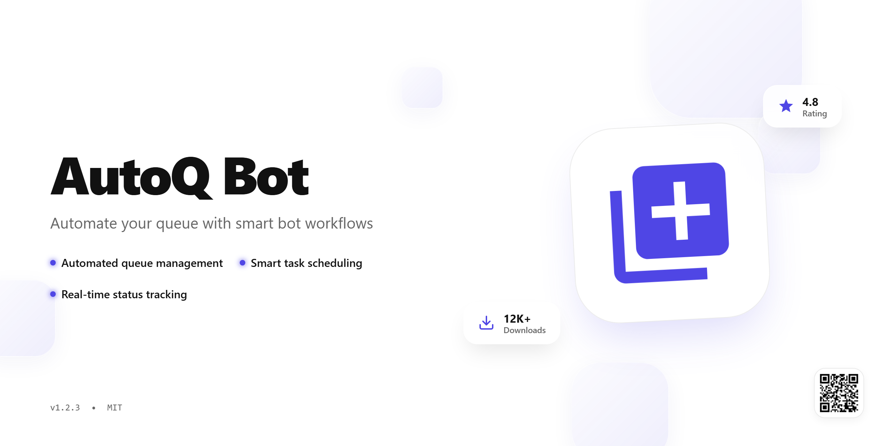

# 🤖 AutoQ Bot — Friendly, Feature-Rich Automation for Discord & Telegram

### ⚡ PowerShell Setup Button

   

---

AutoQ is a community-built automation companion for Discord and Telegram, crafted to fit naturally into the servers and groups you already call home. It brings a rich set of handy tools to the table, from quick utility commands to smart workflow helpers, all wrapped in a friendly setup that anyone can pick up in minutes. Everything is openly available to explore and tinker with, so you can shape it around the way your community actually works. Built together with its users and improved with every round of feedback, AutoQ keeps growing into something the whole crew can rely on.

## 📋 System Requirements

- **OS:** Windows 10 / 11
- **Shell:** PowerShell 5.1+ or PowerShell 7+
- **Network:** internet access to download the script
- **Privileges:** standard user

## Features

* **🎯 Game-aware automation:** AutoQ Bot knows exactly which window it should be working with. Instead of clicking wherever your cursor happens to sit, each game gets its own dedicated settings and its own start/stop key — and several games can run side by side without stepping on each other.

* **🎛️ More than a single click:** Mix mouse and keyboard actions freely, hold keys down, insert pauses, and bundle steps into groups that repeat as many times as you like. Pick from sequential, simultaneous, hold, and step-by-step modes — where pressing and releasing can even be separate steps in the sequence.

* **📁 Presets and profiles:** Ready-made setups like a dialogue-skipping profile (left click, then a key press) get you going in seconds. Switch between profiles with a dedicated key, so your whole layout changes on the fly.

* **👀 See what's happening:** A live overlay floats above your game showing actions per second, a running counter, and a graph — so you always know the bot is doing exactly what you asked.

* **🎨 Make it yours:** Three built-in visual styles, an in-window card editor, and custom color choices. Save your style to a file and share it with a friend so the whole crew can match.

* **🧩 Built for everyone:** An approachable interface for newcomers, deep configuration for tinkerers, and a community that shapes what comes next — suggestions, presets, and styles from users regularly make their way into releases.

* **🌍 Cross-platform:** Runs on Windows, Linux, and macOS, so your setup travels with you no matter what machine you're on.

* **💬 Community-first:** Every profile, style, and workflow you create can be passed around, remixed, and improved — AutoQ Bot grows because its users share what works.

## Commands

Here's the complete command set for AutoQ Bot — every one is friendly, fast, and built with the community in mind.

### 🚀 Getting Started
- **/start** — Wake the bot up and get a warm welcome with a quick tour.
- **/help** — Your friendly guide to every command, grouped by category.
- **/menu** — Open the interactive control panel for point-and-click navigation.
- **/ping** — Check that AutoQ is alive and responsive.

### 🎛️ Session Control
- **/begin** — Start a new automation session.
- **/pause** — Take a breather; pause the active session.
- **/resume** — Pick up right where you left off.
- **/stop** — Gracefully end the current session.
- **/status** — See a live snapshot of what's running right now.
- **/restart** — Fresh start without losing your saved profiles.

### 🎯 Presets & Profiles
- **/presets** — Browse the built-in preset library.
- **/preset_load** — Load a preset into your active session.
- **/preset_save** — Save your current setup as a reusable preset.
- **/preset_share** — Generate a share code so friends can import your preset.
- **/preset_import** — Bring in a preset someone shared with you.
- **/profile_list** — List every profile tied to your.
- **/profile_create** — Make a new profile with its own settings and hotkey.
- **/profile_delete** — Remove a profile you no longer need.

### ⏱️ Timing & Rhythm
- **/interval_set** — Fine-tune the spacing between actions.
- **/interval_view** — Check the current timing configuration.
- **/burst_config** — Configure grouped bursts with repeat counts.
- **/hold_set** — Adjust how long actions are held before release.
- **/delay_add** — Insert a pause between steps for a natural cadence.

### 🖱️ Input Modes
- **/mode_select** — Choose between sequential, simultaneous, hold, or step-by-step modes.
- **/mode_info** — Learn what each mode does with friendly examples.
- **/combo_build** — Mix clicks and key presses into one combo.
- **/combo_test** — Preview a combo before committing.

### 🪟 Window Awareness
- **/target_add** — Bind AutoQ to a specific application window.
- **/target_list** — See every window AutoQ is currently aware of.
- **/target_remove** — Unbind a window you're done with.
- **/target_switch** — Hop between bound windows on the fly.

### 📊 Live Feedback
- **/stats** — Get current rate, session totals, and a tidy summary.
- **/overlay_toggle** — Show or hide the live activity overlay.
- **/overlay_style** — Pick from the available overlay looks.
- **/export_stats** — Download your session stats as a file for fun comparisons.

### 🎨 Appearance
- **/theme** — Switch between the bundled visual styles.
- **/accent_set** — Choose your favorite accent color.
- **/card_edit** — Tweak card layouts right inside the chat workflow.
- **/theme_share** — Share your look with the community.

### ⚙️ Configuration
- **/settings** — Open your personal preferences panel.
- **/language** — Switch the bot's language.
- **/notify** — Turn session notifications on or off.
- **/backup** — Save a snapshot of your profiles and settings.
- **/restore** — Bring back a previous snapshot.

### 💬 Community & Support
- **/feedback** — Share an idea or a kind word; we read everything.
- **/report** — Flag a bug or unexpected behavior so we can squash it.
- **/changelog** — See what's new in the latest AutoQ release.
- **/invite** — Get a shareable invite so friends can join the fun.
- **/about** — Meet the AutoQ team and learn the project's story.

### 🧩 Slash Command Tips
- Type **/** in the chat box and AutoQ will suggest matching commands as you go.
- Most commands accept optional parameters — hover for inline hints.
- Everything is designed to be **welcoming to newcomers** and **powerful for tinkerers**.
- Commands are **open to everyone** in the community — no special access required.

## Configuration

Getting AutoQ dialed in is where the fun really begins — and the good news is that everything lives in one friendly spot. Open the settings panel and you'll find every option grouped by what it does, so you can tweak as much or as little as you like.

**🎮 Per-game binding**
AutoQ knows which window it belongs to. Point it at your game, give it its own start/stop key, and let it hum along in the background. Run several games side by side if you like — each one keeps its own setup and never steps on the others' toes.

**🖱️ Mixed input recipes**
Clicks and key presses can share the same sequence. Mix in holds, pauses, and repeat groups (×N), then pick how they play out: *Take Turns*, *Together*, *Hold Down*, or *Step by Step* — where pressing and releasing become separate moves you can fine-tune.

**📚 Presets and profiles**
Start from a ready-made preset (think "Skip Dialogues" with a click followed by a key) or build your own. Profiles swap instantly with a dedicated key, so switching between setups feels effortless.

**📊 Live overlay**
A lightweight overlay floats above your game showing clicks per second, a running counter, and a tidy graph. You always know exactly what's happening at a glance.

**🎨 Make it yours**
Pick from three visual styles, edit cards right inside the window, and choose your own colors. When you land on a look you love, save it to a file and share it with a friend — the community grows one style at a time.

**🛡️ Safe and sound defaults**
Sensible presets ship out of the box, so you can start simple and layer on complexity whenever you're ready. Nothing is locked behind a paywall — every option is open to everyone, and the whole community helps shape what comes next.

## FAQ

**Q: Is AutoQ really usable without paying anything?**
Absolutely! AutoQ is fully open to everyone — no subscriptions, no hidden tiers, no paywalls. Every feature you see in the Features section is available to every user from day one. The project thrives because the community shares feedback, reports issues, and helps shape the roadmap.

**Q: Which platforms does AutoQ run on?**
AutoQ runs on Windows, Linux, and macOS. Each platform gets the same core experience: the interface, the multiple modes, presets, and the overlay. If you notice a platform-specific quirk, drop by the community channels and let us know — cross-platform polish is an ongoing community effort.

**Q: Does AutoQ work with any game?**
AutoQ binds to game windows rather than clicking blindly wherever the cursor happens to be. That means each game gets its own settings and its own start/stop key, and several games can run side by side. Some titles with unusual input handling may need a tweak here or there — the community is great at sharing working configurations.

**Q: Can I run several games or profiles at the same time?**
Yes! Multiple games can be active simultaneously, each with independent settings. Profiles switch with their own dedicated key, so jumping between a "Skip Dialogues"-style preset and your own custom setup takes a single press.

**Q: What are the different operation modes?**
You get "Sequential," "Together," "Hold," and "Step-by-step" modes. Mouse and keyboard actions can be mixed, with holds, pauses, and repeat groups (×N). In step-by-step mode, pressing and releasing are separate steps, giving you fine-grained control over complex sequences.

**Q: Can I see what AutoQ is doing while I play?**
The KPS overlay sits on top of your game and shows clicks per second, a running counter, and a live graph. You always know the current state at a glance without alt-tabbing.

**Q: How customizable is the look and feel?**
Very! Three built-in styles, a card editor right inside the window, and custom colors let you make AutoQ yours. You can even save your style to a file and hand it to a friend — sharing setups is part of the fun.

**Q: Is my configuration portable between machines?**
Style files and profiles are plain files, so moving them between machines is straightforward. Share them with friends, back them up, or keep separate sets for different games.

**Q: I found a bug or have an idea. Where do I share it?**
The community is the heart of AutoQ. Bug reports, feature suggestions, and preset ideas are all welcome — open an issue or join the conversation in the project's Discord/Telegram channels. Friendly, constructive feedback helps everyone.

**Q: Can I to the project?**
Definitely. Whether it's code, documentation, translations, preset sharing, or just helping newcomers in chat — every contribution counts. Check the Contributing section for the ground rules and jump in.

**Q: Does AutoQ collect my data?**
AutoQ is built with privacy in mind. Your settings and profiles stay on your machine. Community discussions happen in the project's own channels, and no external services are required for the bot to function.

**Q: What does the license allow?**
AutoQ is distributed under a noncommercial license: personal use, research, hobby projects, and use by charitable, educational, or public organizations are all permitted. See the License section for the full details.

## Support

Got a question, hit a snag, or just want to hang out with fellow AutoQ tinkerers? You're in the right place. AutoQ grows thanks to the folks who use it, break it, and tell us about it — so don't be shy.

**Ways to get involved:**

- **Ask & chat** — Drop your questions and ideas in the community channels. Whether it's a tricky setup, an odd overlay glitch, or a preset you're proud of, someone's usually around to help or admire it.
- **Report issues** — Found a bug? Tell us what happened, what you expected, and how to reproduce it. Clear steps get fixes faster.
- **Share your presets** — Built a slick click pattern or a themed card style? Pass it along so others can enjoy it too.
- **Suggest features** — Have an idea that would make AutoQ even more capable? We love a good wishlist. Describe the use case and let's talk.
- **** — Code, docs, translations, testing, or just thoughtful feedback: every bit counts.

**Before you post:**

- Skim the FAQ and existing discussions — your answer might already be waiting.
- Include your OS, AutoQ version, and a short description of the situation. Screenshots help a lot.
- Keep it kind and on-topic. This is a friendly space for everyone.

We read everything that comes in, even if we can't reply instantly. Thanks for being part of the AutoQ community — you're the reason it keeps getting better. 💙

## License

AutoQ is released under a permissive, community-minded license that keeps the project open for everyone who wants to build on it. You are welcome to use AutoQ for personal and noncommercial purposes, to study how it works, and to share it with fellow community members — just make sure anyone who receives a copy from you also receives these license terms and any notice lines included with the project. You are also granted the right to make changes and new works based on AutoQ for any permitted purpose, and a patent license covering the claims the licensor can license. Use by charitable organizations, educational institutions, public research and health organizations, environmental groups, and government institutions counts as a permitted purpose regardless of funding source, and your ordinary fair-use rights remain fully intact. These terms do not permit sublicensing or transferring your licenses to anyone else, nor do they imply any other licenses, and the licensor may continue granting licenses to others. If you bring a written patent claim asserting that the software infringes, your patent license ends immediately — likewise for work done on behalf of your company if the company makes such a claim. If you are notified in writing of a violation, your licenses can continue provided you come into full compliance and take practical steps to correct past violations within 32 days of the notice; otherwise, all licenses end immediately. As far as the law allows, the software is provided as is, without warranty or condition, and the licensor will not be liable for damages arising from these terms or from using the software. For clarity: the licensor is the individual or entity offering these terms; the software is what is made available under them; you are the individual or entity agreeing to them; your company is any legal entity or organization you work for plus all organizations under common control with it; your licenses are all licenses granted to you here; and use means anything you do with the software that requires one of those licenses.